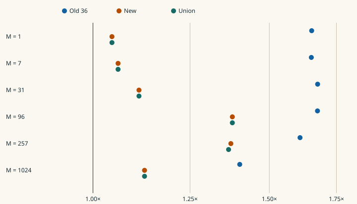

# quartet

A Triton matmul autotuner, measured against `torch.matmul` on 96 LLM-shaped workloads on a T4, an A10, an L4 and an H100.

[](https://mottopanikeiku.github.io/quartet/)

Choosing among the 36 stock configurations turned out to cost very little here. The configuration picked on one timing pass was within 0.7% of the fastest on a second pass, on all four GPUs. On the T4 and H100, though, even that best configuration was much slower than torch on the same card. So on the H100 I wrote ten more kernels, and they cut Triton's latency by 27%, from 1.61× torch's to 1.17×.

Geometric-mean latency relative to torch (lower is faster), original 36 configurations, selected on one timing pass and scored on another:

| GPU | Triton / torch | Loss vs fastest configuration |
|---|---:|---:|
| T4 | 3.84× | 0.65% |
| A10 | 1.02× | 0.32% |
| L4 | 0.99× | 0.37% |
| H100 | 1.61× | 0.08% |

The new H100 kernels are four larger tensor-core tiles, two persistent TMA kernels and four split-K kernels for M ≤ 31. Same H100 session:

| H100 kernel set | Triton / torch | Workloads faster than torch |
|---|---:|---:|
| Original 36 | 1.61× | 0 |
| Ten new kernels | 1.17× | 9 of 96 |
| Both | 1.17× | 9 of 96 |

The new kernels improve 95 of 96 workloads. Most of the nine wins over torch are small; the largest is 5.5%, on Qwen2.5-7B's FFN-down projection at M = 1. Six of the nine come from split-K and three from the larger tiles. Per-workload numbers are in the [report](https://mottopanikeiku.github.io/quartet/).

## How it works

- 36 Triton configurations vary tile sizes, warps, pipeline stages and program ordering.
- A linear Thompson-sampling bandit probes configurations and fits a latency model. Replaying the saved H100 timings offline, with its posterior shared across workloads, it reaches 99.7% of the exhaustive pick at 8 probes per workload. Seeding it with other GPUs' measurements didn't help ([comparison](results/tuner-comparison.md)).
- Split-K splits the reduction across programs, writes FP32 partial tiles and sums them in a second kernel. Timings include both launches and the workspace allocation.
- The baseline is warmed-up `torch.matmul`, without cuBLASLt tuning or CUDA graphs. Everything uses FP16 operands on Torch 2.8.0 and Triton 3.4.0.

## Run it

Python 3.11–3.13 and [uv](https://docs.astral.sh/uv/). Replaying the stored measurements needs no GPU:

```sh
uv sync --locked --extra dev
uv run heliostune compare benchmarks/data/measurements.jsonl.zst --source A10 --target L4 --max-budget 8 --seeds 1 --output artifacts/a10-to-l4.json
uv run python scripts/build_site.py --check
```

Use `--seeds 30` for the full comparison, and drop `--check` to rebuild the report page and figure. Tests are `uv run pytest -q`; the GPU tests need `--extra gpu`.

To collect new H100 timings, preview the plan, then run it on a CUDA machine (each run ID keeps its own checkpoint):

```sh
uv run python scripts/collect_action_expansion.py --run-id h100-repeat-1 --gpu H100 --dry-run
```

The protocol is in [docs/action-expansion.md](docs/action-expansion.md). The Python package and CLI are still called `heliostune`, this project's old name; the kernels live in `src/heliostune/kernel.py` and `action_expansion.py`, and the raw timings for all four GPUs in `benchmarks/data/`. MIT license.
